# Faultline: the interface, page by page

These pictures were taken from the running application, in LIVE mode, by `scripts/capture_ui.py`. Nothing is drawn or edited: the script opens each page in a browser, shows the real analysis of the main example (the library `faultline-fixture-acme-models` against the consumer `faultline-fixture-notify-svc`), and saves what is rendered. Each picture is the whole page. The light theme is shown here; the dark theme of every page is in the same folder with the suffix `-dark`.

Window size 1440 x 900 px; each picture is as tall as its page. The full-size files are in `docs/screenshots/`.

## Contents

- **The product site**: [Product site: home](#01-home), [Product site: how it works](#02-how-it-works), [Product site: capabilities](#03-capabilities)
- **The workspace**: [Workspace: Overview](#10-overview), [New analysis](#11-new-analysis), [Findings](#12-findings), [Finding detail (BREAK WITNESSED)](#13-finding), [Witness detail](#14-witness), [Finding detail (INCONCLUSIVE)](#15-finding-inconclusive), [World matrix](#16-world-matrix), [Relationships](#17-relationships), [Inventory graph](#18-inventory-graph), [Evidence](#19-evidence), [Jobs](#20-jobs), [Repositories](#21-repositories), [Capabilities and coverage](#22-capabilities-and-coverage), [Settings](#23-settings)
- **Close-ups used in the demo**: [Reuse and recomputation (the twist)](#30-reuse-panel), [Analysis funnel](#31-funnel)

## The product site

### Product site: home

The public front page. It states the claim (witnesses, not warnings) before anyone logs in.

Route: `#/`

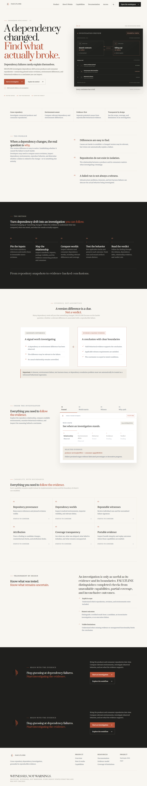

Dark theme: [`01-home-dark.png`](screenshots/01-home-dark.png)

### Product site: how it works

The pipeline in plain steps: pin, relate, build two worlds, run three times each, witness, attribute, fix.

Route: `#/how`

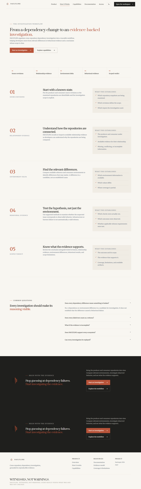

Dark theme: [`02-how-it-works-dark.png`](screenshots/02-how-it-works-dark.png)

### Product site: capabilities

What is supported and what is not, stated openly.

Route: `#/capabilities`

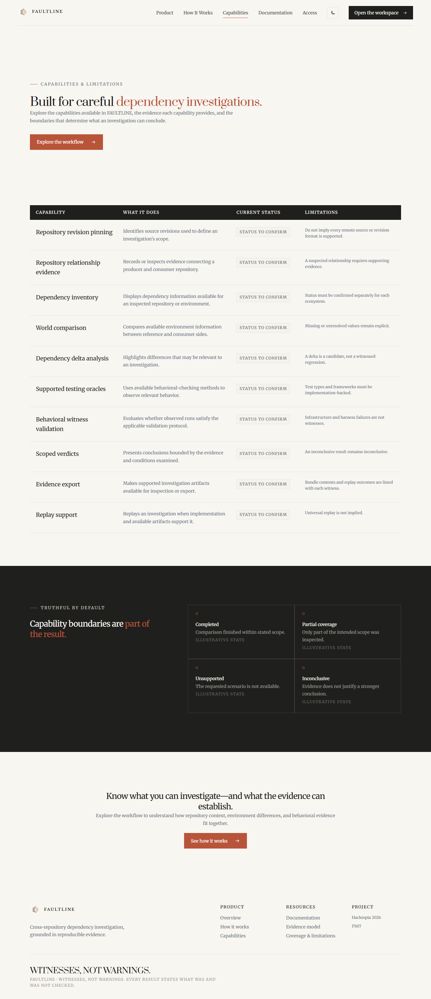

Dark theme: [`03-capabilities-dark.png`](screenshots/03-capabilities-dark.png)

## The workspace

### Workspace: Overview

Counts of investigations and findings, the outcome chart, jobs by status, the Reuse and recomputation panel, the analysis funnel and what needs attention.

Route: `#/app`

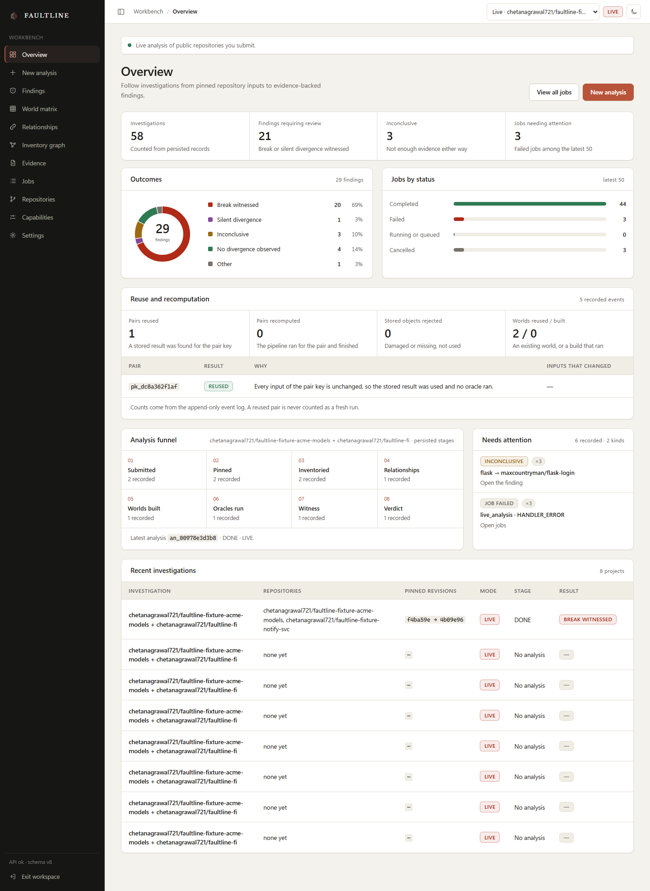

Dark theme: [`10-overview-dark.png`](screenshots/10-overview-dark.png)

### New analysis

Paste the library and the consumer. Both are pinned to exact commits before anything runs.

Route: `#/app/new`

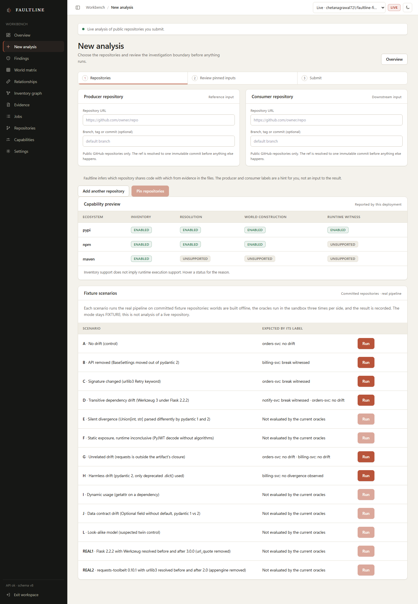

Dark theme: [`11-new-analysis-dark.png`](screenshots/11-new-analysis-dark.png)

### Findings

Every verdict in one list, with its mode (LIVE) and the sentence that states what was and was not shown.

Route: `#/app/findings`

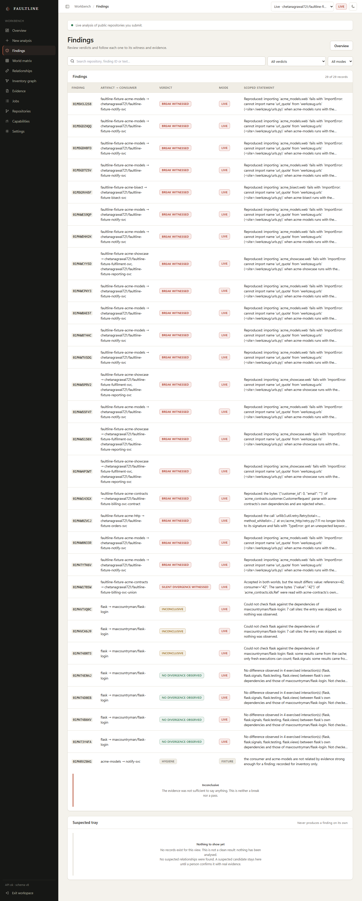

Dark theme: [`12-findings-dark.png`](screenshots/12-findings-dark.png)

### Finding detail (BREAK WITNESSED)

The scoped verdict, what the evidence establishes, the why-path, both worlds, the dependency delta, the six runs, the scope, re-run and fix.

Route: `#/app/finding/fnd_01M5H3J2S8C3SBJG1WFVQSJ65K`

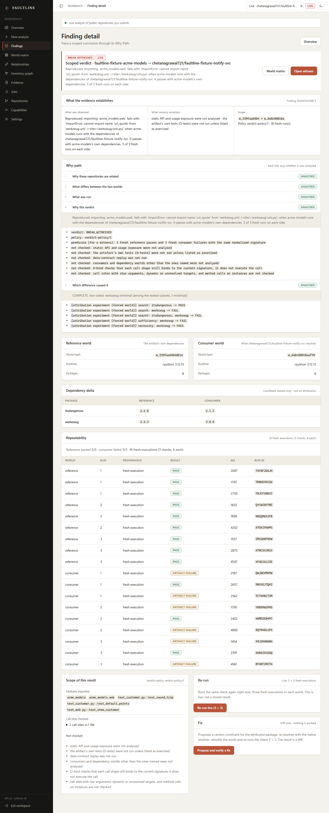

Dark theme: [`13-finding-dark.png`](screenshots/13-finding-dark.png)

### Witness detail

Three fresh passes against three fresh failures with the same signature, the six-run board and the raw output.

Route: `#/app/witness/fnd_01M5H3J2S8C3SBJG1WFVQSJ65K`

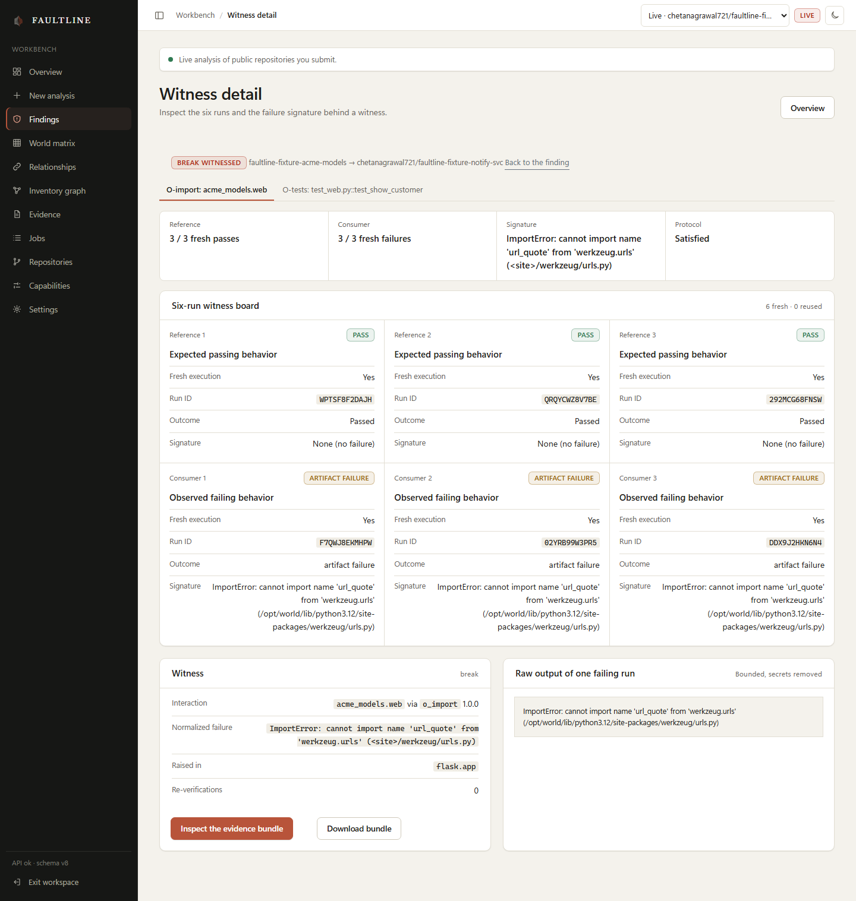

Dark theme: [`14-witness-dark.png`](screenshots/14-witness-dark.png)

### Finding detail (INCONCLUSIVE)

An unsettled result is never shown as a pass: the reasons are listed, grouped by cause.

Route: `#/app/finding/fnd_01M4VTVQ0CHQ2X5G98EVSPGP0P`

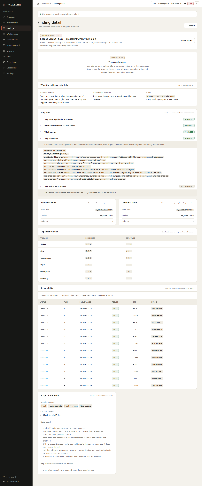

Dark theme: [`15-finding-inconclusive-dark.png`](screenshots/15-finding-inconclusive-dark.png)

### World matrix

The reference world, the consumer world, and the exact delta: only the packages whose versions differ.

Route: `#/app/worlds`

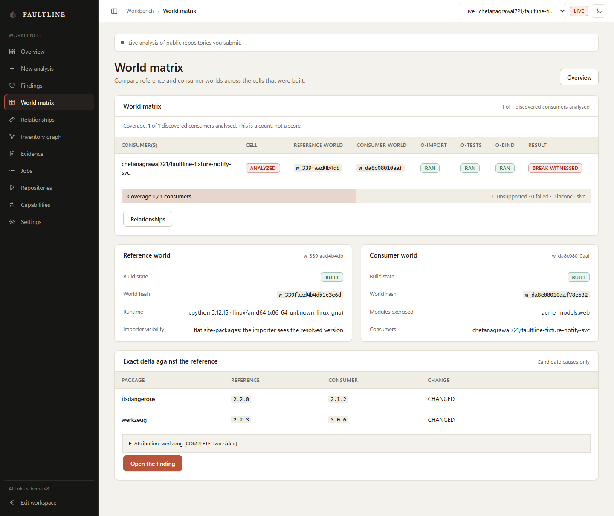

Dark theme: [`16-world-matrix-dark.png`](screenshots/16-world-matrix-dark.png)

### Relationships

Why two repositories are related: the file and line in both manifests at the pinned commit.

Route: `#/app/relationships`

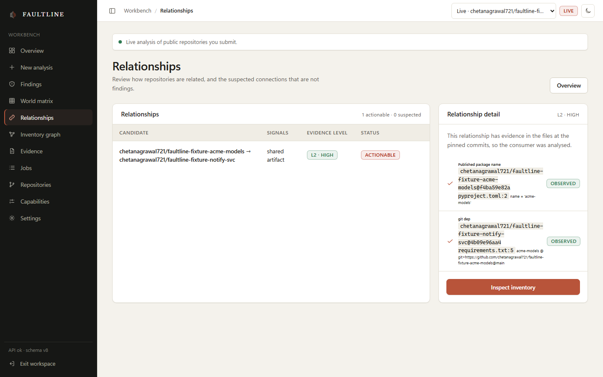

Dark theme: [`17-relationships-dark.png`](screenshots/17-relationships-dark.png)

### Inventory graph

Repositories, manifests and packages as a graph with evidence-backed edges.

Route: `#/app/inventory`

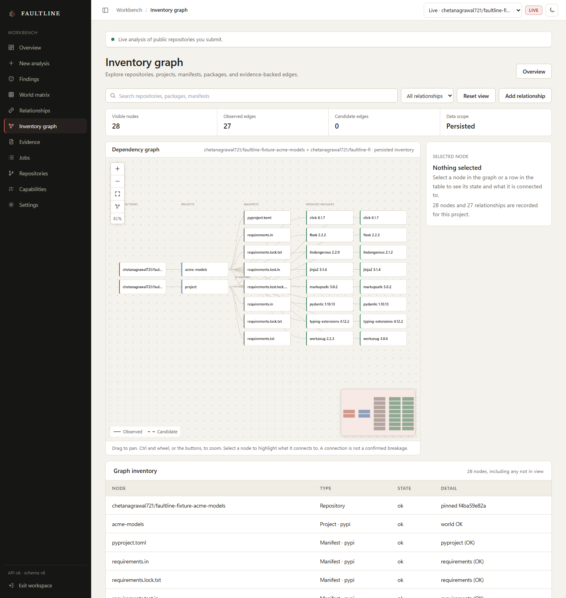

Dark theme: [`18-inventory-graph-dark.png`](screenshots/18-inventory-graph-dark.png)

### Evidence

The bundle behind a witness: artifacts with their SHA-256, the manifest, integrity and replay.

Route: `#/app/evidence`

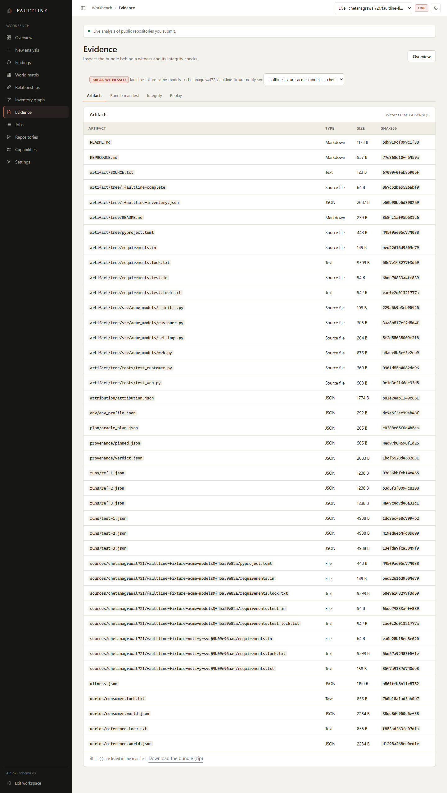

Dark theme: [`19-evidence-dark.png`](screenshots/19-evidence-dark.png)

### Jobs

Every background job with its status, run time, wait time, failure class and attempts.

Route: `#/app/jobs`

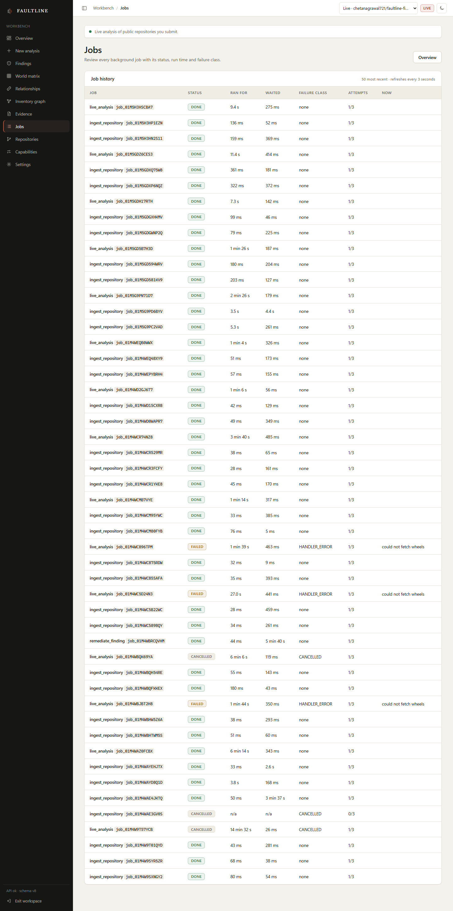

Dark theme: [`20-jobs-dark.png`](screenshots/20-jobs-dark.png)

### Repositories

The pinned snapshot of each repository and its inventory.

Route: `#/app/repository`

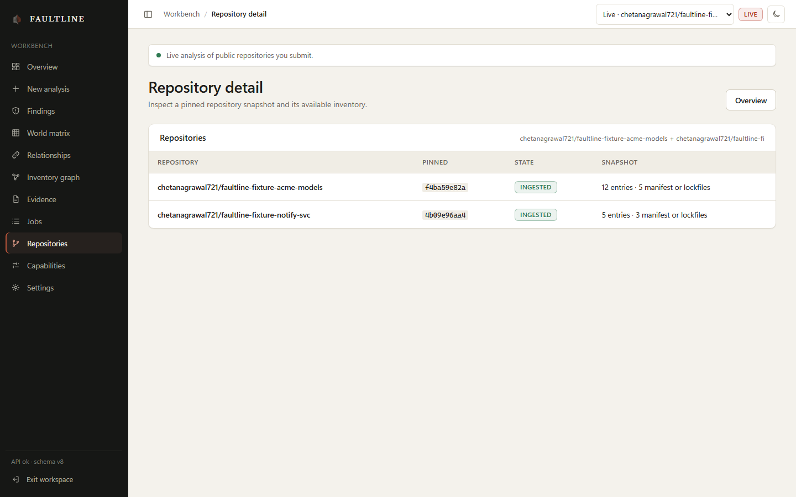

Dark theme: [`21-repositories-dark.png`](screenshots/21-repositories-dark.png)

### Capabilities and coverage

What this deployment can do per ecosystem, which oracles exist and which features are enabled.

Route: `#/app/coverage`

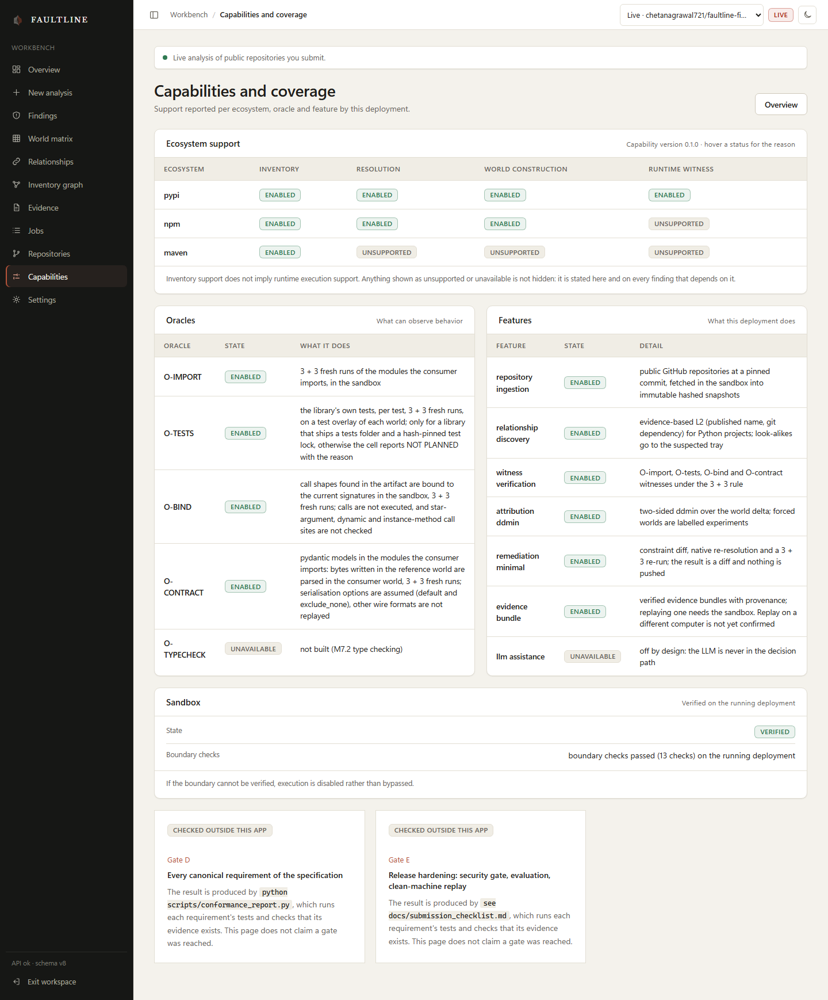

Dark theme: [`22-capabilities-and-coverage-dark.png`](screenshots/22-capabilities-and-coverage-dark.png)

### Settings

Theme, access token and application information.

Route: `#/app/settings`

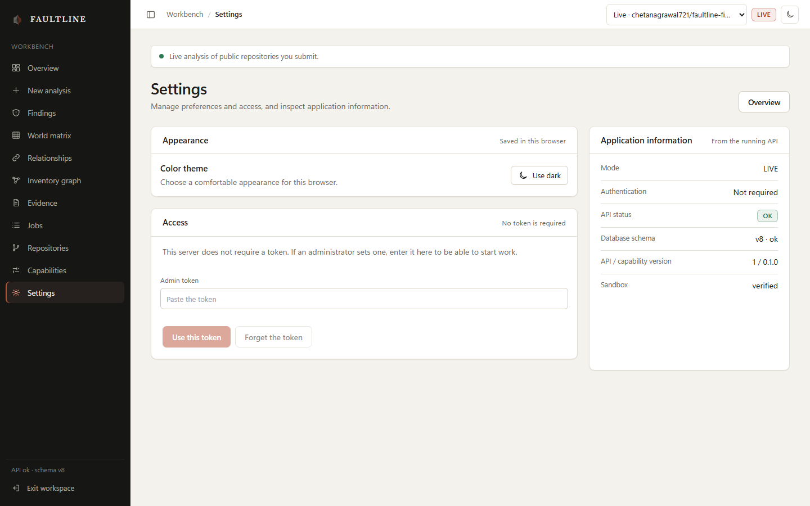

Dark theme: [`23-settings-dark.png`](screenshots/23-settings-dark.png)

## Close-ups used in the demo

### Reuse and recomputation (the twist)

Pairs reused, pairs recomputed, stored objects rejected, worlds reused and built, with the reason for each pair. Counted from the append-only event log.

Route: `#/app (crop)`

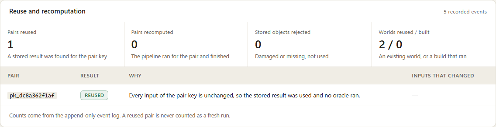

Dark theme: [`30-reuse-panel-dark.png`](screenshots/30-reuse-panel-dark.png)

### Analysis funnel

Every stage as a recorded count, from submitted to verdict.

Route: `#/app (crop)`

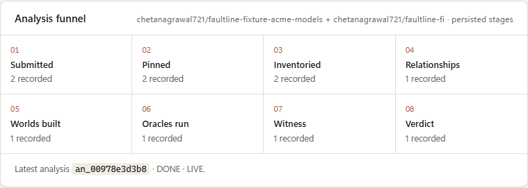

Dark theme: [`31-funnel-dark.png`](screenshots/31-funnel-dark.png)

